

  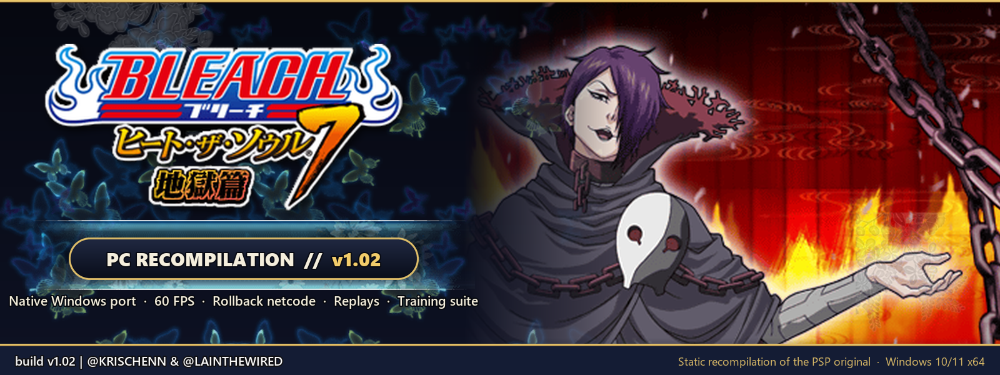

  
  
  
  

  
  
  

<b>A native Windows port of <i>BLEACH: Heat the Soul 7</i> (PSP), made by static recompilation.</b> 
<code>build v1.02 | @KRISCHENN &amp; @LAINTHEWIRED</code>

  <a href="https://github.com/krprojecthts/Bleach-HTS7-Releases/releases/latest"><b>⬇ Download the latest release</b></a> ·
  <a href="https://krprojecthts.github.io/Bleach-HTS7-Releases/"><b>Website</b></a> ·
  <a href="#install"><b>Install</b></a> ·
  <a href="https://discord.gg/qJt89H2NCR"><b>Report a bug</b></a>

> [!IMPORTANT]
> This repository holds **releases, documentation and issues only**. No game data is distributed. To play, you need your own copy of the Japanese disc **UCJS-10110**: its disc image (`.iso`) and the decrypted `EBOOT.BIN`.

 

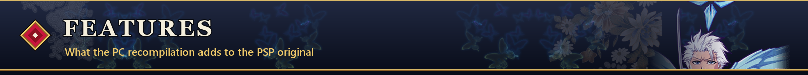

| | |
|---|---|
| 🎞️ **60 FPS presentation** | 60 pictures a second through Vulkan: an in-between picture is drawn between every two game frames. The game itself runs at 30, as on the PSP, so timing and combos are unchanged. |
| 🔆 **Upgraded lighting & shaders** | Internal resolution up to 6×, texture upscaling, MSAA and anisotropic filtering. A post-processing pass adds bloom, contrast, warmth, sharpening and ambient occlusion. Battle stages get key light, sky and ground bounce, and haze, set per stage. |
| 🌐 **Rollback netcode & rebuilt online lobby** | Quick Match, Ranked (FT2) with Soul Points and Soul Rate, public and private rooms, Live Matches spectating, Fighter Cards, and Direct Connect. Ping and rollback are shown under the fighters' names. |
| 🎬 **Replay Theater with MP4 export** | Press SELECT on any results screen to save the battle. The REPLAYS card plays it back and exports it straight to an MP4 video. |
| 🥋 **Training Mode suite** | Frame data (startup, active, recovery, advantage), input display, dummy recording and playback, Ghost Sparring, playback speed from 100% down to 10%, and instant position reset. |
| 👥 **Battle Royale, restored** | Four-player Battle Royale on every versus stage, with each fighter's alternate colours. |
| 🔄 **Automatic updates** | At start the game checks this repository's GitHub Releases in the background and sends nothing about you. A newer release shows a quiet pill on the main menu. *PC Settings ▸ Check for Updates* verifies the download (size and SHA-256), installs it and restarts. Saves, settings and replays are never touched. |
| 🎮 **PC controls** | XInput controllers and keyboard, remappable, with PlayStation, Xbox or PC button icons. Western menu layout (cross confirms). |
| 🎵 **Your own music** | BGM Jukebox and custom soundtrack packs. |
| 🧩 **Texture mods** | Built-in texture dumping and HD replacement (Extra ▸ △ Texture Mods). |

 

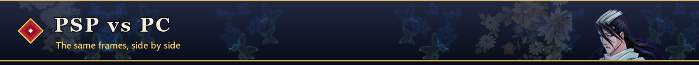

The same scripted battle rendered twice by the port, frame for frame: on the left as the PSP draws it (480×272, software), on the right as the PC recompilation does.

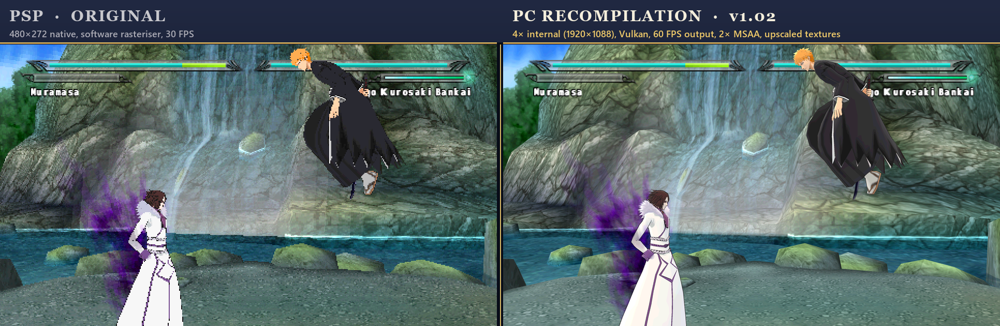

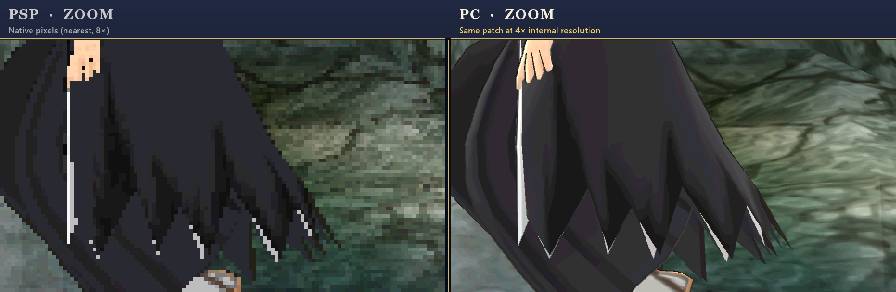

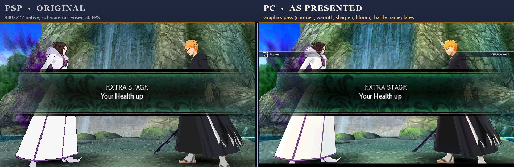

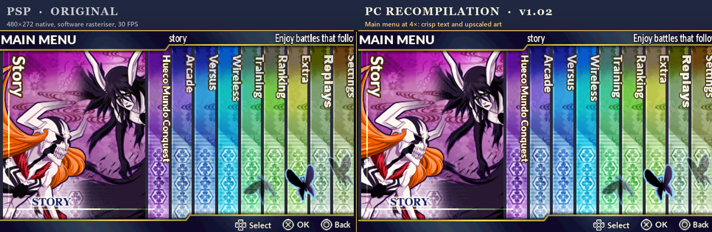

 

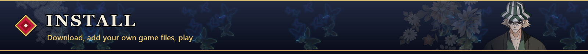

**Needs:** 64-bit Windows 10 or 11 and a graphics driver with Vulkan (any recent NVIDIA, AMD or Intel driver). The Visual C++ runtime is included.

1. **Download** the `.zip` from the [latest release](https://github.com/krprojecthts/Bleach-HTS7-Releases/releases/latest) (no GitHub account needed) and extract it to its own folder, for example `C:\Games\BLEACH HTS7 PC\`. Do not run it from inside the zip.
2. **Add your game files.** Put your **decrypted `EBOOT.BIN`** of UCJS-10110 in the `game\` folder. `game\README.txt` explains how to get it with PPSSPP (*Settings ▸ Tools ▸ Developer tools ▸ Dump decrypted EBOOT.BIN on game boot*). Keep your **disc image (`.iso`)** anywhere.
3. **Play.** Double-click `BleachNative.exe`. On the first start the **DISC SETUP** screen asks for your `.iso` and checks both files: *READY (UCJS-10110 v1.01)* is best, and the v1.00 disc works too. Press START to launch.

`QUICKSTART.txt` in the release covers controls, settings, online play, replays, training tools and troubleshooting. Updating is automatic (see above), or extract a newer release over the old folder. Your saves stay in `memstick\`.

 

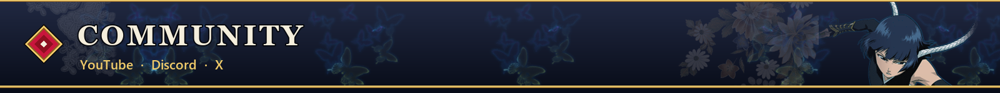

| | Where | For |
|---|---|---|
| ▶️ | **[YouTube — @bleachheatthesoul7pc](https://youtube.com/@bleachheatthesoul7pc?si=MUqVwYzm2hlHhivd)** | Gameplay and match footage |
| 💬 | **[Discord](https://discord.gg/qJt89H2NCR)** | Finding players, sharing knowledge, **reporting bugs** |
| 𝕏 | **[X — @recompsociety](https://x.com/recompsociety?s=11)** | Upcoming-update teasers, and other PC recompilation projects and fans |

Found a bug? Report it on Discord, or open an [issue](https://github.com/krprojecthts/Bleach-HTS7-Releases/issues). Include `BleachNative.log` from beside the exe.

 

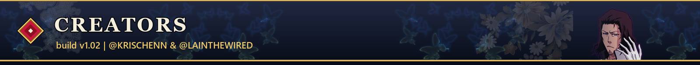

  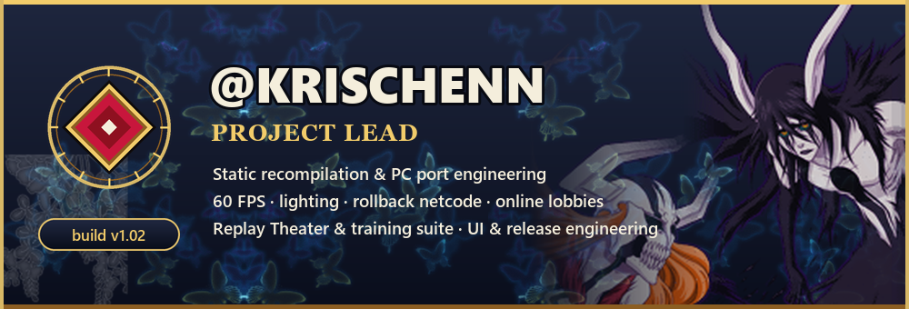
  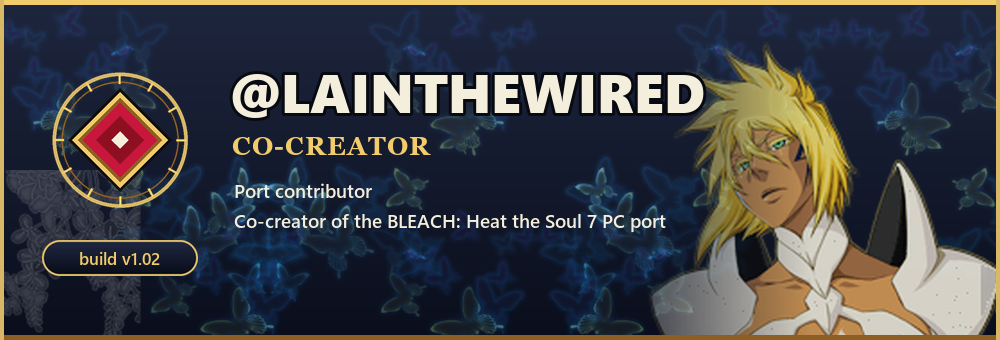

- **@KRISCHENN** (Project Lead): static recompilation and PC port engineering; 60 FPS, lighting, rollback netcode and online lobbies; Replay Theater and the training suite; UI and release engineering.
- **@LAINTHEWIRED** (Co-Creator): port contributor.

 

## License

**Copyright © 2026 @KRISCHENN & @LAINTHEWIRED. All Rights Reserved.** See [`LICENSE`](LICENSE).

You may not copy, fork, modify, redistribute, mirror, reverse-engineer, or port this work into another engine (Unreal Engine, Unity, Godot or any other) without written permission from both authors.

Open-source components inside the port keep their own licenses (see `LICENSE`, section 4). *BLEACH* and its characters belong to Tite Kubo / Shueisha. *BLEACH: Heat the Soul 7* belongs to Sony Interactive Entertainment and Eighting. This is an unofficial fan project, not affiliated with or endorsed by them. Game imagery is shown only to identify and document the port.
